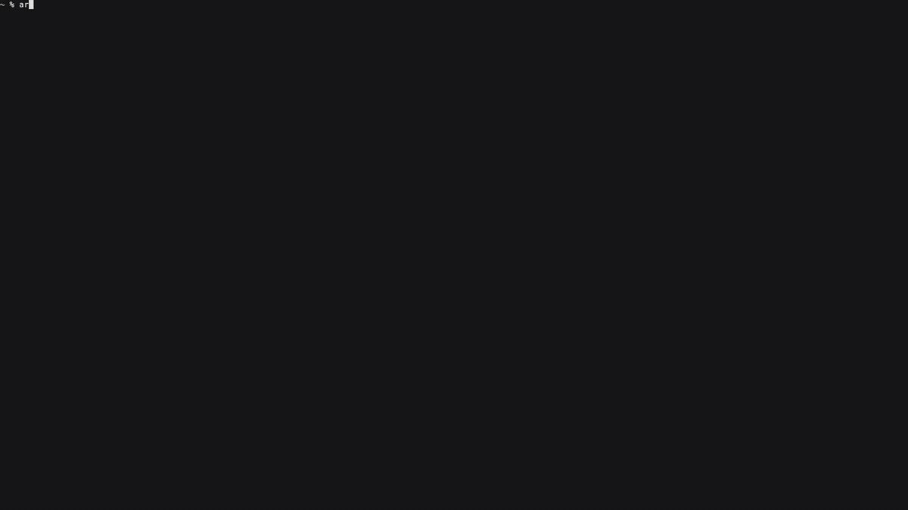

# argus

**English** · [Português](README.pt-BR.md)

**A terminal panel for people who run many coding agent sessions at once.** Every session is the real [Claude Code](https://claude.com/claude-code), [opencode](https://opencode.ai), [Gemini CLI](https://github.com/google-gemini/gemini-cli) or Codex, in tmux. Argus sits on the left and tells you which one needs you, how much of each account's limit is left, and brings back the right session in a keystroke.



## Why

With a dozen sessions across projects and accounts, the hard part stops being the code. It's knowing which session is waiting on a permission prompt, which finished ten minutes ago, and whether the work account will hit its 5-hour limit before lunch. Argus answers that at a glance and stays out of the way: no daemon, no polling, about 16 MB of memory.

## What it does

**Know who needs you**
- Open sessions listed by conversation title, grouped by project, with their state: working, waiting for you, done. A desktop notification when one changes.
- `y` answers a session waiting for you from the list: its question and options show under it. `Tab` jumps to the next one.
- Tabs on top for the open sessions; click to switch.

**Keep every account in view**
- Several profiles: two Claude accounts (`CLAUDE_CONFIG_DIR`), opencode, Gemini, Codex. Each session is colored by its account.
- The footer shows each Claude account's 5-hour and 7-day usage, with a mark for how much of the window has passed and a warning when your pace runs out before the reset.
- `a` moves a session to another account and keeps the conversation.

**Get back to any conversation**
- Past conversations of Claude Code and opencode, grouped by folder. `h` searches titles as you type and then the full text of every conversation. Enter resumes.
- Names you give a session (`r`) stay with the conversation.
- After a reboot or a crash, Argus offers to reopen what was open, each in its account.

**Work next to the agent**
- `e` opens a code column: an editor ([Fresh](https://getfresh.dev), with LSP) in the session's folder that opens each file the agent changes, at the changed line. It stays with its session and survives restarts.
- `d` shows the folder's diff; `w` starts a session on a new git worktree so two agents never step on each other.
- `v` shows every session's screen side by side; `g` shows today's timeline.

**Stay light**
- A long conversation gets a `/compact` between turns when its context passes `compact_at` (off by default), instead of compacting by itself mid-task. `C` hands the work over to a new conversation in the same place.
- Idle sessions hibernate after 2 hours: the process closes to free memory and Enter resumes it where it stopped.
- `T` picks a theme (dark, night, synthwave, pink, vibrant, bordeaux, light). It applies live to the panel, every Claude Code session on the Argus theme and the editor.
- `argus bench` checks the performance budget: hook under 5 ms per event, panel under 0.5% CPU when idle, under 30 MB of memory. The footer warns when something on the machine runs away.

Each session is the real CLI in a real terminal, so memory, MCP servers, skills, hooks and permissions work as usual. The screen follows your system language (English or Portuguese; `ARGUS_LANG=en` or `pt` forces one).

## Install

macOS or Linux, tmux 3.4+ (`brew install tmux` / `apt install tmux`), git (for worktrees). The code column needs [Fresh](https://getfresh.dev) (`brew install fresh-editor`) or any editor set in the config.

```sh
curl -fsSL https://raw.githubusercontent.com/Marcone-Santos1/argus/main/install.sh | sh
argus install   # hooks for Claude Code, Codex and Gemini, the opencode plugin, tmux config, themes
argus           # open the panel
```

The script downloads the latest release, checks its SHA-256 and puts `argus` in `~/.local/bin` (`ARGUS_INSTALL_DIR` changes it). Other ways:

```sh
brew trust marcone-santos1/tap && brew install marcone-santos1/tap/argus-panel   # Homebrew
go install github.com/Marcone-Santos1/argus/cmd/argus@latest                      # from source (Go 1.26+)
```

`argus install` appends one hook to each agent's settings, next to the hooks already there, and leaves a backup. `argus uninstall` removes everything.

## Keys

<details>
<summary>All keys (<code>?</code> shows them in the panel)</summary>

| Key | Action |
| --- | --- |
| `↑` `↓` | select; an open session shows on the right |
| `Enter` | enter the session, open a folder, or resume a past conversation |
| `Ctrl+\` | switch between the list, the code column and the session (from anywhere) |
| `Tab` | jump to the next session waiting for you |
| `y` | answer a session waiting for you, from the list |
| `n` | new session: project and profile (a path starting with `/` or `~` picks any folder; it can be created) |
| `w` | new session in a worktree of the selected repository |
| `h` | full history, searchable by title and text |
| `/` | filter the list |
| `r` | rename the session (the name stays with the conversation) |
| `R` | restart the session on the same conversation, to pick up new MCP servers, skills or settings |
| `c` | compact the session now (`/compact`, keeping what `compact_focus` says) |
| `C` | continue in a new conversation: the session writes a handoff, then a fresh conversation picks it up in the same place |
| `a` | move the session to another account, keeping the conversation |
| `e` | code column: an editor in the session's folder that follows the agent's edits |
| `d` | diff of the selected folder |
| `v` | overview: every session's screen side by side |
| `g` | today's timeline: when each session worked, waited for you or sat idle |
| `t` | templates: start a saved session (folder, account and first message), or save the selected one |
| `T` | choose the theme; moving previews it everywhere, Enter applies |
| `b` | fold the list into a thin rail (and back) |
| `[` `]` | move the session up or down the list |
| `< >` | narrow / widen the list (or drag the border) |
| `L` | switch between the app look and the classic one |
| `z` | zoom |
| `Esc` | hide the session on the right without closing it (or clear the filter) |
| `x` | close the session (and offer to delete its worktree) |
| `1`–`9` | jump to a session |
| `q` | close the panel; sessions keep running in tmux |

Mouse: click selects (a session shows on the right), double click enters; click a tab on top to switch.

</details>

## Configuration

`~/.config/argus/config.toml` holds the project folders, profiles, per-folder profile rules, the session limit, which status changes notify you (`notify = ["waiting", "done"]`), the editor (`editor = "fresh"`), `hibernate_after` (`"0"` turns hibernation off), `compact_at` and `compact_focus` (when and how a long conversation is compacted), `handoff_prompt` and `handoff_resume` (what `C` asks for: a file by default, or a memory tool's handoff) and `storm_rate`, the processes per minute that raise the footer's alarm (2000 by default, `-1` turns it off).

Argus also watches the `remote-settings.json` a Claude Team or Enterprise organization pushes to each account and warns you (panel and notification) when it changes, naming what was set, such as `env.OTEL_LOG_USER_PROMPTS`.

A profile is a command with its environment:

```toml
[[profile]]
name = "claude-work"
command = "claude"
env = { CLAUDE_CONFIG_DIR = "~/.claude-work" }
```

Each session row shows its profile's tag. Set `display = "Claude work"` on a profile to change it, or press `r` to name a single session.

## How it works

A dedicated tmux server (`tmux -L argus`) holds the sessions. The panel sits on the left and swaps the session on the right with `swap-pane`. Status comes from files in `~/.local/state/argus/`, written by the Claude Code, Codex and Gemini hook (plain shell, one process per event) and by the opencode plugin. The panel watches those files with kqueue/inotify, so nothing polls.

The full specification, with rules, performance targets and decisions, is in [`docs/especificacao.html`](docs/especificacao.html) (Portuguese).

## Development

```
cmd/argus/          the command
internal/
  bench/            argus bench
  config/           config.toml and per-folder preferences
  gitinfo/          branch, changed files and unpushed commits
  history/          past conversations (Claude transcripts, opencode database)
  i18n/             on-screen text in English and Portuguese
  install/          hook, plugin, themes and tmux config (assets/)
  notify/           desktop notifications
  paths/            on-disk locations
  procs/            process table: memory and CPU per session
  status/           each session's state
  sysmon/           CPU and processes per minute
  tmux/             tmux server client
  ui/               the panel
  usage/            account limits from the status line
  worktree/         git worktrees
```

```sh
make test     # tests (integration tests use real tmux and git, on their own server)
make check    # gofmt, vet and tests with -race (what CI runs, on macOS and Linux)
make install  # build into ~/.local/bin/argus and run argus install
make bench    # measure performance with the panel open
```

Every change must keep `argus bench` within the limits in the specification.

Releases: push a tag (`git tag v0.3.0 && git push --tags`); CI builds the binaries and publishes the release. Then `scripts/update-tap.sh v0.3.0` updates the Homebrew formula.

## License

[MIT](LICENSE).
