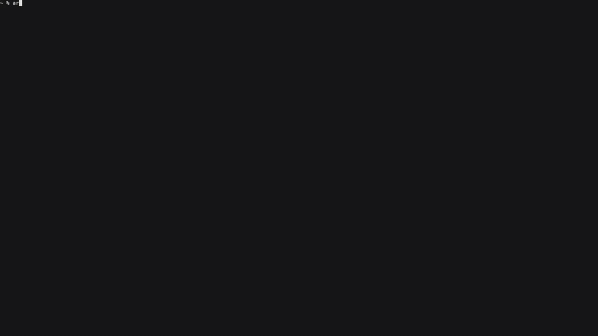

# argus

[English](README.md) · **Português**

**Um painel de terminal para quem roda várias sessões de agentes de código ao mesmo tempo.** Cada sessão é o [Claude Code](https://claude.com/claude-code), [opencode](https://opencode.ai), [Gemini CLI](https://github.com/google-gemini/gemini-cli) ou Codex de verdade, no tmux. O Argus fica à esquerda e mostra qual sessão precisa de você, quanto resta do limite de cada conta, e traz a sessão certa com uma tecla.



## Por quê

Com uma dúzia de sessões entre projetos e contas, o difícil deixa de ser o código. É saber qual sessão está esperando uma permissão, qual terminou há dez minutos e se a conta do trabalho vai bater o limite de 5 horas antes do almoço. O Argus responde isso de relance e não atrapalha: sem daemon, sem polling, uns 16 MB de memória.

## O que faz

**Saber quem precisa de você**
- Sessões abertas listadas pelo título da conversa, agrupadas por projeto, com o estado: trabalhando, esperando você, pronta. Notificação no desktop quando uma muda.
- `y` responde uma sessão que espera você direto da lista: a pergunta e as opções aparecem embaixo dela. `Tab` pula para a próxima.
- Abas em cima com as sessões abertas; clicar troca.

**Todas as contas à vista**
- Vários perfis: duas contas do Claude (`CLAUDE_CONFIG_DIR`), opencode, Gemini, Codex. Cada sessão tem a cor da sua conta.
- O rodapé mostra o uso de 5 horas e de 7 dias de cada conta do Claude, com uma marca de quanto da janela já passou e um aviso quando o ritmo acaba antes de zerar.
- `a` passa uma sessão para outra conta, mantendo a conversa.

**Voltar a qualquer conversa**
- Conversas antigas do Claude Code e do opencode, agrupadas por pasta. `h` busca pelo título enquanto você digita e depois pelo texto de todas as conversas. Enter retoma.
- O nome que você dá a uma sessão (`r`) fica com a conversa.
- Depois de reiniciar a máquina ou de uma queda, o Argus oferece reabrir o que estava aberto, cada uma na sua conta.

**Trabalhar ao lado do agente**
- `e` abre uma coluna de código: um editor ([Fresh](https://getfresh.dev), com LSP) na pasta da sessão, que abre cada arquivo que o agente muda, na linha mudada. Ela fica com a sua sessão e sobrevive a reinícios.
- `d` mostra o diff da pasta; `w` abre uma sessão num worktree novo do git, para dois agentes nunca pisarem um no outro.
- `v` mostra a tela de todas as sessões lado a lado; `g` mostra a linha do tempo do dia.

**Leve**
- Uma conversa longa recebe um `/compact` entre turnos quando o contexto passa de `compact_at` (desligado por padrão), em vez de compactar sozinha no meio de uma tarefa. O `C` passa o trabalho para uma conversa nova no mesmo lugar.
- Sessões paradas hibernam depois de 2 horas: o processo fecha para liberar memória e o Enter retoma de onde parou.
- `T` escolhe o tema (escuro, noite, synthwave, rosa, vibrante, bordô, claro). Vale na hora para o painel, para toda sessão do Claude Code no tema Argus e para o editor.
- `argus bench` confere o orçamento de desempenho: hook abaixo de 5 ms por evento, painel abaixo de 0,5% de CPU parado, menos de 30 MB de memória. O rodapé avisa quando algo na máquina dispara.

Cada sessão é o CLI de verdade num terminal de verdade: memória, servidores MCP, skills, hooks e permissões funcionam como sempre. A tela segue o idioma do sistema (português ou inglês; `ARGUS_LANG=pt` ou `en` força um).

## Instalação

macOS ou Linux, tmux 3.4+ (`brew install tmux` / `apt install tmux`), git (para worktrees). A coluna de código precisa do [Fresh](https://getfresh.dev) (`brew install fresh-editor`) ou de outro editor definido na configuração.

```sh
curl -fsSL https://raw.githubusercontent.com/Marcone-Santos1/argus/main/install.sh | sh
argus install   # hooks do Claude Code, Codex e Gemini, plugin do opencode, config do tmux, temas
argus           # abre o painel
```

O script baixa a última versão, confere o SHA-256 e põe o `argus` em `~/.local/bin` (`ARGUS_INSTALL_DIR` muda). Outras formas:

```sh
brew trust marcone-santos1/tap && brew install marcone-santos1/tap/argus-panel   # Homebrew
go install github.com/Marcone-Santos1/argus/cmd/argus@latest                      # do código (Go 1.26+)
```

O `argus install` acrescenta um hook às configurações de cada agente, ao lado dos que já existem, e deixa um backup. O `argus uninstall` remove tudo.

## Teclas

<details>
<summary>Todas as teclas (<code>?</code> mostra no painel)</summary>

| Tecla | Ação |
| --- | --- |
| `↑` `↓` | seleciona; uma sessão aberta aparece à direita |
| `Enter` | entra na sessão, abre uma pasta ou retoma uma conversa antiga |
| `Ctrl+\` | alterna entre a lista, a coluna de código e a sessão (de qualquer lugar) |
| `Tab` | pula para a próxima sessão que espera você |
| `y` | responde uma sessão que espera você, da lista |
| `n` | nova sessão: projeto e perfil (um caminho começando com `/` ou `~` escolhe qualquer pasta; dá para criar) |
| `w` | nova sessão num worktree do repositório selecionado |
| `h` | histórico completo, com busca por título e texto |
| `/` | filtra a lista |
| `r` | renomeia a sessão (o nome fica com a conversa) |
| `R` | reinicia a sessão na mesma conversa, para pegar MCP, skills ou configurações novas |
| `c` | compacta a sessão agora (`/compact`, guardando o que diz `compact_focus`) |
| `C` | continua numa conversa nova: a sessão escreve um handoff e uma conversa nova retoma dele no mesmo lugar |
| `a` | passa a sessão para outra conta, mantendo a conversa |
| `e` | coluna de código: um editor na pasta da sessão que segue as edições do agente |
| `d` | diff da pasta selecionada |
| `v` | visão geral: a tela de todas as sessões lado a lado |
| `g` | linha do tempo do dia: quando cada sessão trabalhou, esperou você ou ficou parada |
| `t` | modelos: abre uma sessão salva (pasta, conta e primeira mensagem), ou salva a selecionada |
| `T` | escolhe o tema; mover mostra em tudo, Enter aplica |
| `b` | recolhe a lista numa faixa fina (e volta) |
| `[` `]` | sobe ou desce a sessão na lista |
| `< >` | estreita / alarga a lista (ou arraste a borda) |
| `L` | alterna entre o visual de app e o clássico |
| `z` | zoom |
| `Esc` | tira a sessão da direita sem fechar (ou limpa o filtro) |
| `x` | fecha a sessão (e oferece apagar o worktree) |
| `1`–`9` | pula para uma sessão |
| `q` | fecha o painel; as sessões continuam no tmux |

Mouse: clique seleciona (a sessão aparece à direita), clique duplo entra; clique numa aba em cima para trocar.

</details>

## Configuração

`~/.config/argus/config.toml` guarda as pastas de projetos, os perfis, as regras de perfil por pasta, o limite de sessões, quais mudanças de estado notificam (`notify = ["waiting", "done"]`), o editor (`editor = "fresh"`), o `hibernate_after` (`"0"` desliga a hibernação), o `compact_at` e o `compact_focus` (quando e como uma conversa longa é compactada), o `handoff_prompt` e o `handoff_resume` (o que o `C` pede: um arquivo por padrão, ou o handoff de uma ferramenta de memória) e o `storm_rate`, os processos por minuto que disparam o alarme do rodapé (2000 por padrão, `-1` desliga).

Um perfil é um comando com seu ambiente:

```toml
[[profile]]
name = "claude-work"
command = "claude"
env = { CLAUDE_CONFIG_DIR = "~/.claude-work" }
```

Cada linha de sessão mostra a etiqueta do perfil. `display = "Claude trabalho"` num perfil muda o texto, ou `r` dá nome a uma sessão só.

## Como funciona

Um servidor tmux próprio (`tmux -L argus`) guarda as sessões. O painel fica à esquerda e troca a sessão da direita com `swap-pane`. O estado vem de arquivos em `~/.local/state/argus/`, escritos pelo hook do Claude Code, Codex e Gemini (shell puro, um processo por evento) e pelo plugin do opencode. O painel observa esses arquivos com kqueue/inotify, então nada fica consultando.

A especificação completa, com regras, metas de desempenho e decisões, está em [`docs/especificacao.html`](docs/especificacao.html).

## Desenvolvimento

```
cmd/argus/          o comando
internal/
  bench/            argus bench
  config/           config.toml e preferências por pasta
  gitinfo/          branch, arquivos mudados e commits não enviados
  history/          conversas antigas (transcrições do Claude, banco do opencode)
  i18n/             textos da tela em inglês e português
  install/          hook, plugin, temas e config do tmux (assets/)
  notify/           notificações do desktop
  paths/            lugares no disco
  procs/            tabela de processos: memória e CPU por sessão
  status/           o estado de cada sessão
  sysmon/           CPU e processos por minuto
  tmux/             cliente do servidor tmux
  ui/               o painel
  usage/            limites das contas, lidos da status line
  worktree/         worktrees do git
```

```sh
make test     # testes (os de integração usam tmux e git reais, num servidor próprio)
make check    # gofmt, vet e testes com -race (o que o CI roda, no macOS e no Linux)
make install  # compila em ~/.local/bin/argus e roda o argus install
make bench    # mede o desempenho com o painel aberto
```

Toda mudança precisa manter o `argus bench` dentro dos limites da especificação.

Versões: crie uma tag (`git tag v0.3.0 && git push --tags`); o CI compila e publica a versão. Depois `scripts/update-tap.sh v0.3.0` atualiza a fórmula do Homebrew.

## Licença

[MIT](LICENSE).
